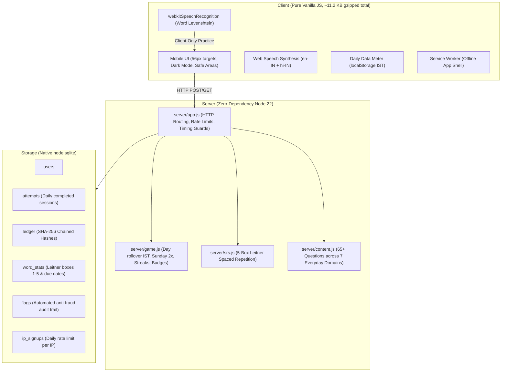

Ref: KL-7Q4

# Roz - English in 3 minutes a day

> **Product thesis:**  
> Most reward apps pay for tapping. Roz pays for **learning**: you listen, you speak, and the words you forget come back at the right time. And because the points matter, **every point is explained and can be verified**.

Roz is a small, resilient daily web app built for Indian language learners using budget Android phones over modest mobile data. Each day has a short 3-minute challenge: listen to spoken English, tap the matching picture, and practice speaking aloud with real-time pronunciation scoring. Learners earn points, maintain streaks, level up, collect badges, review forgotten words via spaced repetition, and climb a weekly leaderboard.

- **Live Demo:** [https://temporary-spry-squall-smo71fq-85qvjvatt-anon-tau-sage.vercel.app/](https://temporary-spry-squall-smo71fq-85qvjvatt-anon-tau-sage.vercel.app/) *(Alternative preview link: [https://spry-squall-smo71fq.tmp.now](https://spry-squall-smo71fq.tmp.now))*
- **GitHub Repo:** [https://github.com/Poi5eN/roz](https://github.com/Poi5eN/roz)
- **Explainer Narrative:** [EXPLAINER.md](EXPLAINER.md)
- **Demo Video Script (2:30):** [docs/DEMO_SCRIPT.md](docs/DEMO_SCRIPT.md)
- **AI Usage Disclosure:** [docs/AI_USAGE.md](docs/AI_USAGE.md)

---

## Architecture



---

## Run Locally (Zero Dependencies)

Requires **Node 22.13 or newer**. Zero external npm dependencies—runs strictly on Node's built-in standard library (`node:sqlite`, `node:http`, `node:crypto`, `node:test`, `node:zlib`).

```bash
# 1. Clone
git clone https://github.com/Poi5eN/roz.git && cd roz

# 2. Run
npm start
# Server running at http://localhost:3000
```

### Tests (22 passing)

Run the comprehensive native test suite (`node:test`):

```bash
npm test
```

Suite covers 22 automated tests:
- Tamper-evident SHA-256 ledger chaining & manual row corruption detection.
- Leitner spaced repetition scheduling, demotion to box 1, and 30-pt practice cap.
- Word-level Levenshtein edit distance and speech normalization.
- Anti-abuse: sub-400ms speed rejection, too-fast finish flags, and IP signup caps.
- Game rules: IST midnight rollover, Sunday 2x multiplier, streak logic, and levels.
- Question bank integrity: 65+ questions, 2 distractors, and unique word options.

---

## Measured Performance on Mobile Data (Slow 3G)

Measured directly in Chrome DevTools with **Slow 3G** throttling and simulated budget Android viewport (360x640):

| Resource | Uncompressed | Gzipped Transfer | Purpose |
|---|---|---|---|
| `index.html` | 1,080 B | **483 B** | Semantic HTML5 structure & accessibility tags |
| `style.css` | 9,980 B | **2,713 B** | High-contrast tokens, 56px tap targets, dark mode |
| `app.js` | 23,280 B | **7,125 B** | State machine, client routing, data meter, audio |
| `speech.js` | 2,860 B | **990 B** | Word-level Levenshtein distance scoring algorithm |
| `icon.svg` | 380 B | **192 B** | Lightweight vector favicon |
| **Total First Load** | **37,580 B** | **11,503 B (~11.23 KB)** | **Well under the 15 KB budget constraint** |

### Daily Network Payload
- Full daily session (`GET /api/daily`, 5 x `POST /api/answer`, `POST /api/finish`): **~2.1 KB total transferred**.
- Real-time IST data consumption is tracked live in `localStorage` and displayed on Home: `📶 Data used today: X.X KB`.

---

## Design Decisions

| Decision | Alternative Considered | Why Roz Made This Choice |
|---|---|---|
| **Server-Side Answer Keys** | Verifying answers on client | Prevents learners or scripts from inspecting network traffic to extract correct answers. The server is the sole arbiter of truth. |
| **Speech Earns Practice Points Only** | Counting speech towards leaderboard | Device speech recognition (`SpeechRecognition`) executes on the client and cannot be cryptographically proven server-side. Excluding it preserves 100% integrity on the weekly leaderboard. |
| **Tamper-Evident Hash Chain** | Plain database total or raw ledger | Because points translate to real economic value, each ledger row is chained via `sha256(prev_hash \| user_id \| day \| kind \| points \| id)`. Any manual SQL edits break the cryptographic chain instantly (`GET /api/ledger/verify`). |
| **5-Box Leitner Spaced Repetition** | Random review questions | Words answered incorrectly in either daily play or practice return to Box 1 (1-day interval). Correct answers graduate across 2, 4, 8, and 16-day intervals, maximizing long-term vocabulary retention. |
| **Zero Runtime Dependencies** | React / Next.js / Express | Eliminates build steps, bundler bloat, and supply chain vulnerabilities. First load stays under 12 KB gzipped, running seamlessly on Android Go and 2G/3G connections. |
| **Device Speech + Fallback** | Large server-side audio models | Audio streaming consumes megabytes of precious data. Browser TTS and STT consume 0 bytes of audio bandwidth. If unsupported or denied, a graceful self-check fallback ensures the user is never blocked. |

---

## Honest Speech & Privacy Notes

1. **Speech Integrity Rule:** Speech recognition runs locally in the user's browser. Because the server cannot audit raw microphone audio, speaking earns **practice points only** (capped at 30/day, recorded as ledger kind `speak`, and strictly excluded from the weekly leaderboard and future payout calculations).
2. **Microphone Privacy:** On Android Chrome, the native speech recognizer may transmit voice data to Google servers for transcription. Roz displays a plain one-sentence permission prompt before activating the microphone: *"Roz uses your microphone to check English pronunciation. Audio is processed by your browser."*
3. **No-Mic Fallback:** If microphone access is denied or unsupported, Roz smoothly switches to a self-check flow (*"Say it aloud, then tap Done"*). Daily progress is never blocked.

---

## What I Left Out and Why

1. **Real Cash Payouts & KYC:** Integrating UPI/payout APIs and KYC requires formal banking partnerships, compliance, and legal rails. Roz's cryptographically chained ledger and `flags` table are specifically designed to feed an audited payout queue.
2. **Phone OTP Authentication:** Currently uses a locally stored session token and username. In production, SMS/WhatsApp OTP via an Indian gateway (e.g., Kaleyra/Twilio) would link accounts to a verifiable phone number.
3. **Durable Cloud Database:** Free hosting tiers (Vercel/Render) run on ephemeral storage, resetting the SQLite file on cold starts. Production deployment would use Postgres or distributed Turso (`libsql`).
4. **Studio-Grade Custom TTS:** Android system voices vary across device manufacturers. Integrating Kenpath's open-source `svara-TTS` would provide consistent, natural Indian-accented English and regional Indic languages.
5. **Heavy Analytics SDKs:** Third-party trackers bloat bundle sizes and consume mobile data. Roz uses an in-house client-side data meter and server-side audit logs.

---

## Deployment

Roz is pre-configured for one-click deployment:
- **Vercel:** Includes `vercel.json` and `api/index.js` for serverless execution using Node 22.
- **Render:** Includes `render.yaml` for containerized free web services.
